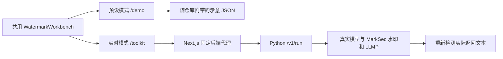

# 接入真实 toolkit 和预设 demo

## 接线



前端固定使用 `/marksec` 路径前缀。可直接挂到现有站点该路径，或在集成时统一调整 Next.js `basePath` 与资源/API 前缀。预设模式不依赖 Python；真实模式不读取预设答案。

## 后端配置

`python -m src.api` 从当前目录 `.env` 读取可选配置，环境变量优先。

| 变量 | 默认值 | 用途 |
| --- | --- | --- |
| `MARKSEC_MODEL_ID` | `HuggingFaceTB/SmolLM2-135M-Instruct` | 服务器选择的 Hugging Face 模型 ID 或本地 safetensors 目录 |
| `MARKSEC_MODEL_REVISION` | `main` | 模型版本；固定 commit hash 可复现同一权重，离线部署需预先下载该版本 |
| `MARKSEC_DEVICE` | `auto` | `auto`、`cpu` 或 `cuda:0`；显式指定的 CUDA 不可用会报错 |
| `MARKSEC_LOCAL_FILES_ONLY` | `false` | 仅使用已下载的本地模型资产 |
| `MARKSEC_API_TOKEN` | 空 | 可选 Bearer 令牌，前端服务器与后端需一致 |

模型必须兼容 Transformers 4.46.1，包含 fast tokenizer 和 safetensors 权重；不运行自定义远程 Python 代码。可配置 `Qwen/Qwen2.5-7B-Instruct` 使用现有 GPU 资产，但本次没有完成 L40 上的 7B 实验验证。135M 小模型适合连通试用，不代替正式研究模型。

前端 `.env.local` 设置 `MARKSEC_BACKEND_URL=http://127.0.0.1:8000` 及可选令牌。这两个变量均为服务端变量，不使用 `NEXT_PUBLIC_` 前缀。代理只转发 health、capabilities、run、detect 四种操作，并按 HTTP Host 拒绝显式跨来源写请求；反向代理需保留浏览器访问的 Host。部署方仍需控制真实接口的访问范围。

单个后端进程保留一个模型并串行执行推理；请使用一个 worker。忙碌请求返回 `429` 和 `Retry-After: 5`，前端代理最多等待 300 秒。

## HTTP 契约

| 方法和路径 | 请求 | 返回 |
| --- | --- | --- |
| `GET /health` | 无 | `status`、`mode=live`、`model_loaded`；不触发模型下载 |
| `GET /v1/capabilities` | 可选 Bearer 认证 | 模型、当前水印列表、当前攻击列表、输出长度上限 |
| `POST /v1/run` | 下方 JSON | `DemoScenario`，含本次实际输出及 `provenance` |
| `POST /v1/detect` | `{"text":"待检测文本","watermark":"KGW"}` | `variant`，含该文本的真实检测结果和 token 标注 |

```json
{
  "prompt": "Explain a zero-knowledge proof with a simple analogy.",
  "watermark": "KGW",
  "attack": "LLMP",
  "max_new_tokens": 128,
  "seed": 42
}
```

`watermark` 可选 `KGW`、`Unigram`；`attack` 目前仅 `LLMP`。prompt 去除首尾空格后长度为 1–4096 字符；输出上限为 16–256 token；输入加输出也受模型上下文窗口约束。模型路径不能通过请求覆盖。

每个 `variants` 元素保留以下字段，真实模式和预设模式共用渲染逻辑：

| 字段 | 内容 |
| --- | --- |
| `text` | 完整结果文本 |
| `tokens` | `text`、`label`（green/red/neutral）、`token_id`、`position` |
| `token_spacing` | 实时结果为 `verbatim`，按 tokenizer offset 保留原文空格 |
| `detection.z_score` | 实际检测分数；token 不足时为 `null` |
| `detection.green_fraction` | 被检测文本中的 green token 比例 |
| `detection.num_scored_tokens` | 实际参与检测的 token 数 |
| `detection.is_watermarked` | 是否超过阈值 |
| `detection.threshold` | 当前检测阈值 |
| `detection.reason` | 无法评分时的原因 |

生成使用 MarkSec 现有水印 backend；改写直接调用 `src/attack/llmp/llmp.py`；输出分数直接来自同一 tokenizer 和水印检测器。KGW 使用 Transformers 实现，Unigram 使用仓库现有 greenlist 实现。API 的 LLMP 与生成共享模型以降低部署负担；原批量实验的辅助模型选择逻辑保留在 CLI 中。

## 错误处理

| 状态 | 含义 | 调用方处理 |
| --- | --- | --- |
| `401` | 缺少令牌或令牌不匹配 | 检查前后端服务器的私有环境配置 |
| `422` | 输入或组合无效、超出模型上下文 | 修正输入；不自动换模型或答案 |
| `429` | 当前模型正在处理请求 | 按 `Retry-After` 重试 |
| `503` | 模型加载/执行失败，或前端未连上后端 | 查看后端日志和模型资产；没有预设兜底 |

健康检查成功不表示模型已经下载成功。应以一次 `/v1/run` 完成作为推理就绪检查。短文本可能无法显著检出水印；改写也不保证能移除水印。

## 预设数据

文件位于 `webpage/public/demo-data/kgw-rw.json` 和 `kgw-llmp.json`。这批原有数据来自预写文本、词级哈希、模拟偏置，`mode=preset` 与 `provenance.kind=illustrative` 明确记录来源。前端不再根据未实际运行的水印选项修改检测数值。

若要更新示意数据，可在仓库根目录运行 `python scripts/annotate_text.py`，无需模型。若替换成实测数据，应保留实际 prompt、模型、参数、检测输出及生成记录，并同步修改来源字段。
